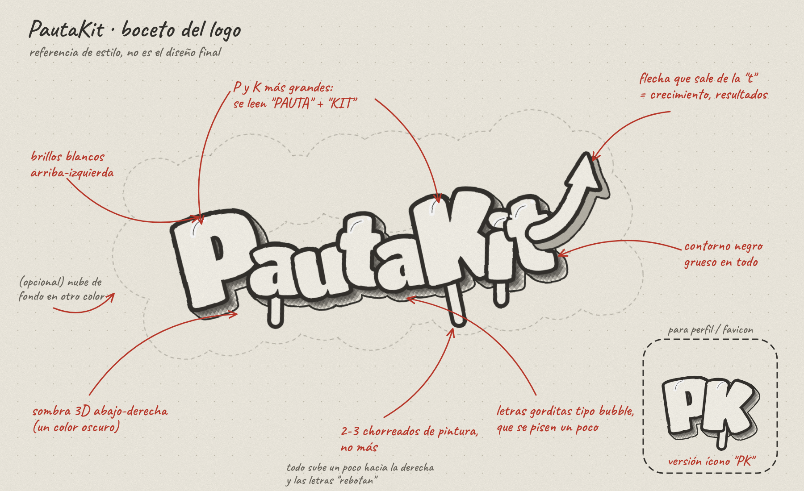
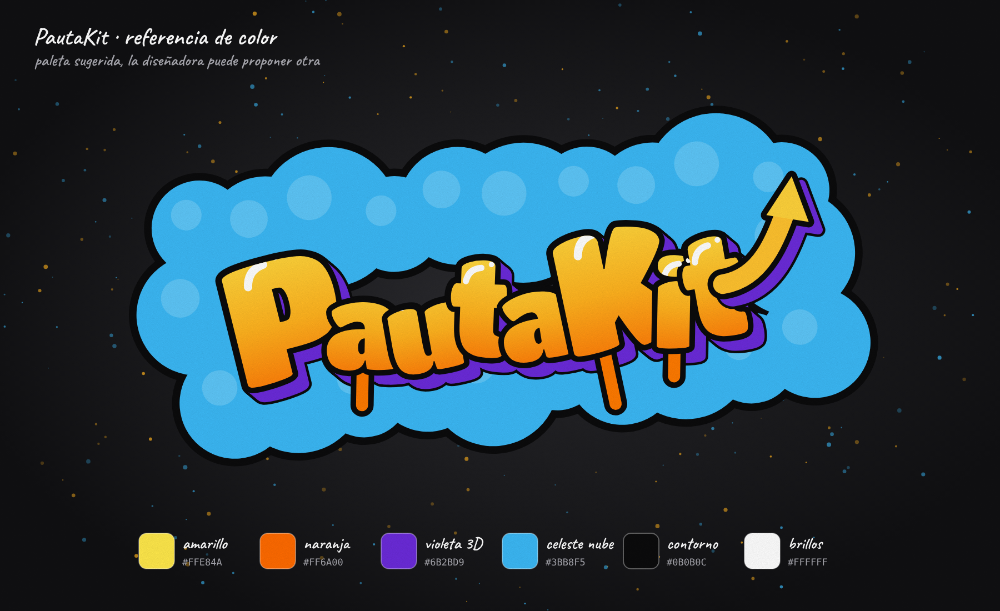

# Oferta: Diseñadora gráfica para el logo de PautaKit

## Qué buscamos

Buscamos una diseñadora gráfica freelance para crear el logo de **PautaKit** en estilo grafiti. Es un proyecto puntual, 100% remoto, y ya tenemos un boceto que marca la dirección (más abajo).

PautaKit es una marca nueva y este logo va a ser su primera pieza de identidad. *[Completar: qué hace PautaKit en una frase y a quién le habla.]*

## El encargo

El logo es la palabra "PautaKit" en lettering grafiti: con actitud de calle, pero lo bastante limpio para usarse en redes, web, stickers y remeras.

Tiene que cumplir con esto:

- **Se lee en un segundo.** "PautaKit" tiene que entenderse de un vistazo, incluso a 110 px (foto de perfil). Nada de wildstyle ilegible.
- **Se siente pintado a mano.** Trazo de aerosol, letras gorditas tipo *throw-up* / *bubble*, no una tipografía de computadora con un filtro encima.
- **Va hacia adelante.** Las letras inclinadas a la derecha y una flecha que sale de la "t" final transmiten crecimiento y resultados.
- **"Pauta" y "Kit" se distinguen.** La P y la K en mayúscula y más grandes, para que se lean las dos palabras.
- **Funciona en una sola tinta.** Si lo pasás a negro plano sobre blanco, tiene que seguir funcionando.

## Boceto de referencia

Este boceto marca la estructura: qué letras, qué efectos y dónde van. Es una guía, no el diseño final: esperamos que lo mejores con tu propio trazo.

Lo que tiene que estar sí o sí:

1. Letras bubble gorditas que se pisan un poco y "rebotan" (no todas a la misma altura).
2. P y K más grandes que el resto.
3. Contorno negro grueso alrededor de todo.
4. Sombra 3D hacia abajo a la derecha.
5. Flecha que sale de la "t" final y sube.
6. Brillos blancos arriba a la izquierda de las letras.
7. Dos o tres chorreados de pintura, no más.

Opcional: una nube de fondo en otro color. Además, una versión ícono con "PK" para foto de perfil y favicon (abajo a la derecha del boceto).

## Guía de estilo

La paleta sugerida es amarillo-naranja con sombra violeta y nube celeste, sobre contorno negro. Si tenés una propuesta mejor, la queremos ver.

| Color | Hex | Uso |
| --- | --- | --- |
| Amarillo | #FFE84A | Relleno de letras (arriba del degradado) |
| Naranja | #FF6A00 | Relleno de letras (abajo del degradado) y chorreados |
| Violeta | #6B2BD9 | Sombra 3D |
| Celeste | #3BB8F5 | Nube de fondo (opcional) |
| Negro | #0B0B0C | Contorno |
| Blanco | #FFFFFF | Brillos |

| Sí | No |
| --- | --- |
| Lettering dibujado a mano, con trazo de aerosol | Una tipografía gratuita con un efecto encima |
| Legible a 110 px | Wildstyle con letras que no se entienden |
| Que funcione en negro plano y sobre fondo claro u oscuro | Depender del degradado o de la nube para que se entienda |
| Pocos detalles bien hechos | Llenarlo de estrellas, coronas y salpicaduras |

## Entregables

Todo en vector editable, con el lettering convertido a curvas.

| Pieza | Formatos |
| --- | --- |
| Logo principal a color, con y sin nube | AI o SVG editable, PDF, PNG transparente de 3000 px de ancho |
| Versión una tinta (negro y blanco) | SVG, PNG transparente |
| Ícono "PK" | SVG, PNG 1024 × 1024 px (que se vea bien recortado en círculo) |
| Paleta final | Códigos HEX, RGB y CMYK |

## Perfil que buscamos

- Portfolio con lettering o grafiti propio: piezas dibujadas por vos, no plantillas.
- Manejo de Illustrator (o similar) para vectorizar a mano con curvas limpias.
- Experiencia haciendo logos que funcionan en tamaños chicos.
- Suma si pintás en la calle o hiciste trabajos para marcas urbanas, música o streetwear.

## Condiciones

El trabajo dura unas dos semanas desde que arrancamos, con dos rondas de cambios incluidas.

| Tema | Detalle |
| --- | --- |
| Modalidad | Freelance, 100% remoto, por proyecto |
| Plazo | Primeras 2 propuestas en 5 días hábiles; versión final a los 10 días hábiles |
| Cambios | 2 rondas de ajustes sobre la propuesta elegida |
| Presupuesto | *[Completar monto]*, o enviá tu cotización con la postulación |
| Pago | 50% al arrancar, 50% contra entrega de los archivos finales |
| Derechos | Cesión total de uso del logo y de los archivos fuente a PautaKit al completar el pago. Lo podés mostrar en tu portfolio. |

## Cómo postular

Mandanos un mensaje a *[Completar: email o WhatsApp]* con el asunto **"Logo PautaKit – tu nombre"** e incluí:

1. Link a tu portfolio (Behance, Instagram o similar).
2. Dos o tres piezas de lettering o grafiti que te representen.
3. Tu cotización y en cuánto tiempo lo podés entregar.

No pedimos bocetos de prueba gratis: elegimos por portfolio y te contamos todo antes de arrancar.
